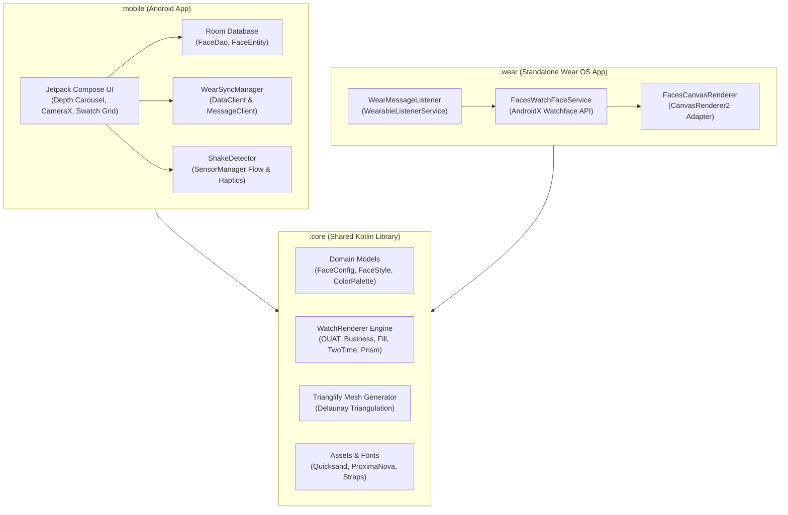

# Faces ⌚🎨

[](https://kotlinlang.org)
[](https://developer.android.com/studio/releases/gradle-plugin)
[](https://developer.android.com/jetpack/compose)
[](https://developer.android.com/wear)
[](https://developer.android.com)
[](https://developer.android.com)

**Faces** is an artisanal photo-to-watch-face companion application for **Android** and **Wear OS**. 

Snap a photo, extract a rich 16-color chromatic palette, customize beautifully crafted watch face templates, and sync them seamlessly to your wrist in real time.

---

## ✨ Features

- 📸 **Photo Palette Extraction**: Snap a photo or choose an image using **CameraX**; the **AndroidX Palette API** extracts and sorts a vibrant 16-color swatch grid.
- 🎨 **Five Handcrafted Watch Face Designs**:
  - **Once Upon A Time**: Typographic word clock with dynamic text fitting and active second counter arc.
  - **Business Time**: Minimalist analog dial featuring precision hour, minute, and interactive ticking second hands.
  - **Filling Time**: Dual-tone diagonal progression filling dynamically with elapsed seconds and inverted contrast text.
  - **Two Time**: Bold split-color typography with stacked digital time representation.
  - **Space-Time Prism**: Algorithmic Delaunay triangulation mesh background generated dynamically in pure Kotlin.
- 📳 **Tactile & Sensorial Customization**:
  - 4x4 circular swatch grid with animated white selection indicators.
  - Tap-to-assign color roles (`BG`, `HR`, `MIN`, `SEC`, `ACC`).
  - **Shake-to-Shuffle**: Shake your handheld device to trigger accelerometer haptic vibration and re-randomize color palettes.
- ⚡ **Real-Time Wrist Sync**:
  - **Instant Preview**: Fast, low-latency live preview via Google Play Wearable `MessageClient`.
  - **Persistent Watch Face**: Offline-first storage and automatic background sync via `DataClient`.
- 🌙 **OLED-Optimized Ambient Mode**:
  - Deep black AMOLED background (`#000000`) to maximize battery life and eliminate screen burn-in.
  - Minimalist hollow-stroke typography and automatic second hand/arc suppression.
- 🖤 **Luxury Dark Aesthetic**:
  - Deep black foundation (`#080a0d`), frosted glass translucent surfaces (`#33ffffff`), crisp white borders, and paired typography (**Quicksand Bold** & **Proxima Nova**).

---

## 🏛️ Architecture & Multi-Module Design



### Module Breakdown

| Module | Description | Technologies |
| :--- | :--- | :--- |
| [**:core**](file:///Users/jvqc8/Documents/Development/Faces-V2/Faces/core) | Shared domain logic, watch rendering math, Delaunay mesh generator, and vector assets. | 100% Kotlin, AndroidX Canvas, Coroutines |
| [**:mobile**](file:///Users/jvqc8/Documents/Development/Faces-V2/Faces/mobile) | Handheld companion application for face browsing, camera capture, customization, and syncing. | Jetpack Compose, CameraX, Room DB, SensorManager |
| [**:wear**](file:///Users/jvqc8/Documents/Development/Faces-V2/Faces/wear) | Standalone Wear OS watch face application. | `androidx.wear.watchface`, Wearable Data Layer |

---

## 🛠️ Tech Stack & Dependencies

- **Language**: 100% Kotlin with Coroutines & StateFlow (Zero Java)
- **UI Framework**: Jetpack Compose (BOM `2024.09.02`) with Material 3
- **Watch Face Engine**: AndroidX Watchface (`androidx.wear.watchface:1.2.1`)
- **Persistence**: Room Database (`2.6.1`) with KSP
- **Camera & Graphics**: CameraX (`1.4.0`, 16 KB page-size aligned), AndroidX Palette (`1.0.0`)
- **Wearable Communication**: Google Play Services Wearable (`18.2.0`)
- **Build System**: Gradle 8.9 with Version Catalog (`gradle/libs.versions.toml`) and Kotlin DSL (`build.gradle.kts`)
- **Minimum SDK**: Android 8.0 (API 26) / Target SDK: Android 14 (API 34)

---

## 🚀 Getting Started

### Prerequisites
- **JDK**: Java 17 or Java 21 (recommended)
- **Android SDK**: API 34 with Build Tools 34.0.0+
- **Android Studio**: Koala / Ladybug or newer

### Building from Command Line

Clone the repository and build both Mobile and Wear OS debug packages:

```bash
# Assemble all debug APKs
./gradlew assembleDebug

# Run unit tests across all modules (:core, :mobile, :wear)
./gradlew test

# Assemble release APKs
./gradlew assembleRelease
```

### Installing on Connected Devices

```bash
# Install companion app to connected Android phone
./gradlew :mobile:installDebug

# Install watch face to connected Wear OS watch (or emulator)
./gradlew :wear:installDebug
```

---

## 🎮 Watch Face Modes & Interactions

### Mobile Companion
1. **Depth Carousel**: Swipe horizontally between saved watch faces with a scale-down depth transition (adjacent slides scale to 0.75x).
2. **Ambient Toggle**: Preview how your face looks in battery-saving ambient mode in real time.
3. **Palette Customizer**: Tap color swatches to assign roles, or give your device a physical shake to shuffle assignments.
4. **Push to Watch**: Tap "Sync to Watch" to broadcast the palette to your Wear OS device instantly.

### Wear OS Watch Face
- **Active Mode**: Crisp 1 Hz ticking, animated second arcs, and dynamic fill progressions.
- **Ambient Mode**: Switches to a low-bit monochrome hollow-stroke style with a deep black background (`#000000`) to save battery and protect AMOLED screens.
- **Display Shapes**: Automatically adapts to both circular (`WatchShape.ROUND`) and rectangular (`WatchShape.SQUARE`) bezels.

---

## 👥 Authors & Credits

- **Kyle Montague** ([@kylemontague](https://github.com/kylemontague))
- **Ryan McLeod**

Modernized with contemporary Android and Wear OS standards (Jetpack Compose, AndroidX Watchface, Room, CameraX, and Kotlin Coroutines).

---

## 📄 License

This project is open-source under the terms of the project repository license.